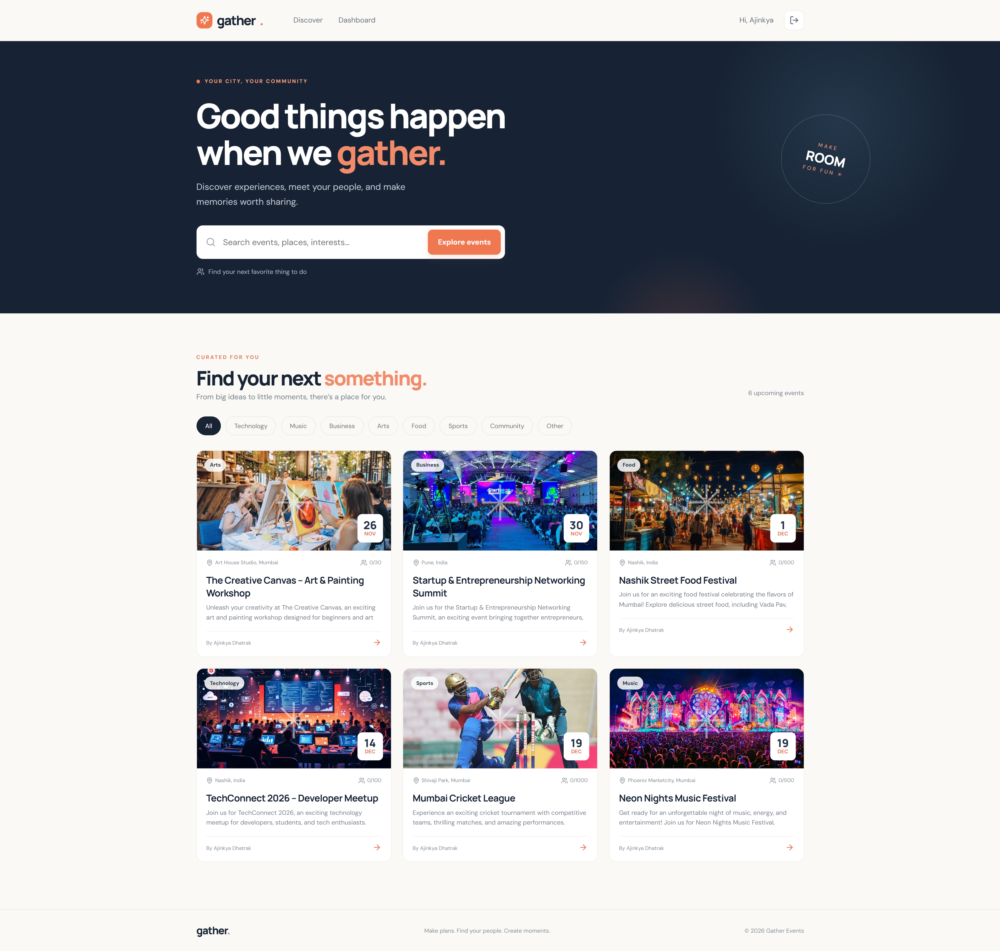
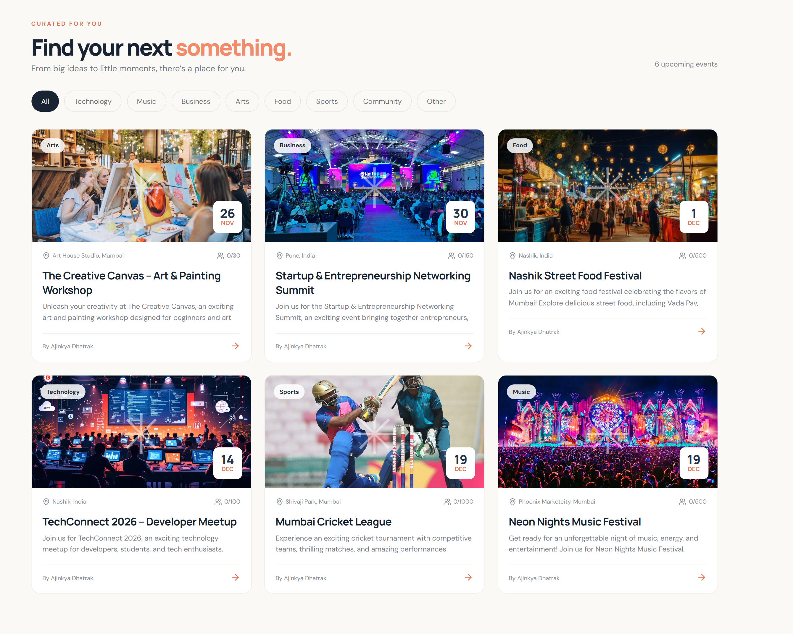
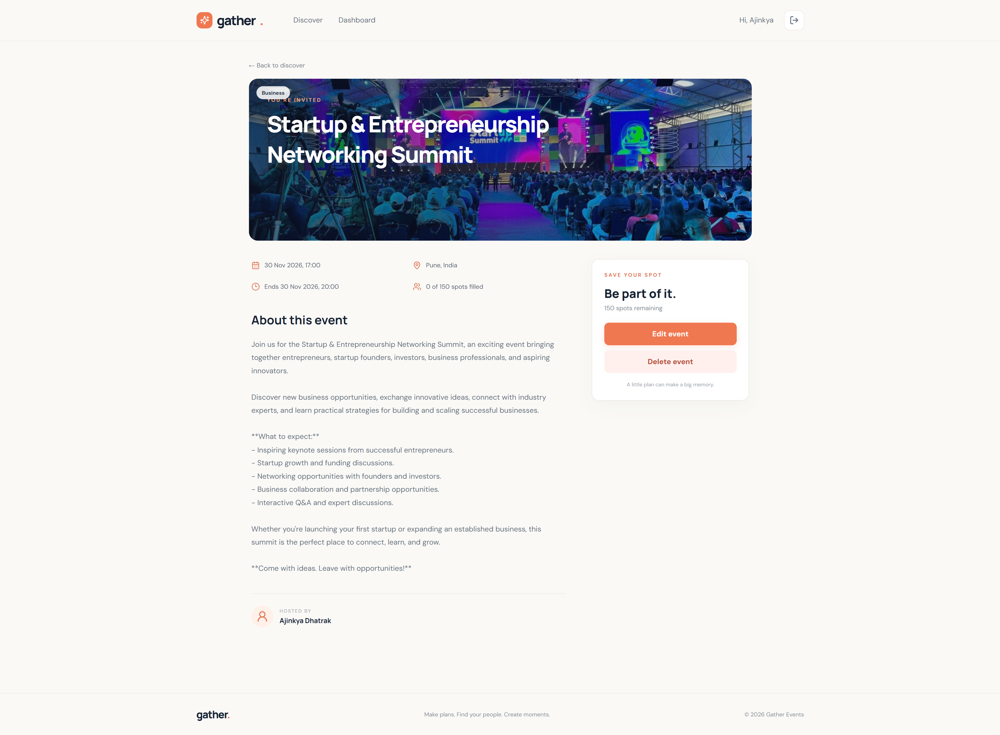
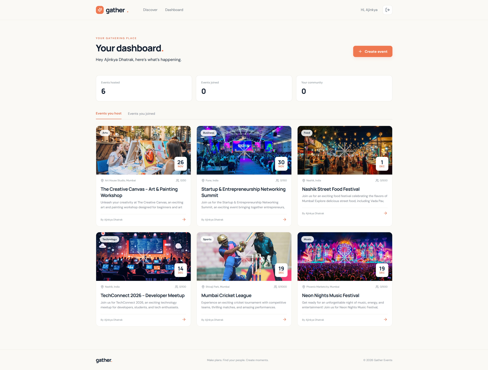
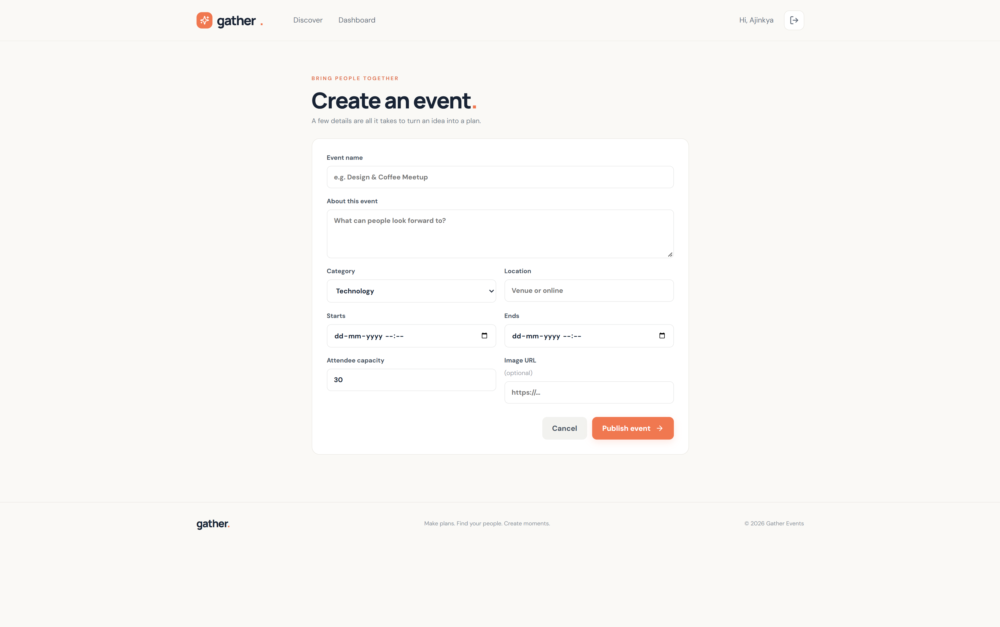

# 🎉 Gather – Event Management Platform

<p align="center">
  A full-stack MERN application that makes discovering, organizing, and managing events simple and seamless.
</p>

<p align="center">
  
  
  
  
  
  
</p>

---

## 📸 Project Screenshots

<!-- Replace the image paths below with your actual screenshots -->

### Homepage



### Events Listing



### Event Details



### Dashboard



### Create Event



---

## 📖 About the Project

**Gather** is a full-stack Event Management Platform built using the MERN stack (MongoDB, Express.js, React.js, and Node.js).

The platform allows users to discover upcoming events, create and manage their own events, register for events, and track their event activities through a personalized dashboard.

Whether it's a technology meetup, music festival, business conference, or sports tournament, Gather provides a centralized platform for bringing people together.

## ✨ Features

### 🔐 Authentication

- User registration and login.
- JWT-based authentication.
- Password hashing using bcrypt.
- Protected routes and user-specific access.

### 🎫 Event Management

- Create new events.
- Edit and delete events.
- View detailed event information.
- Set event categories, locations, dates, and capacity.
- Add event cover images using image URLs.

### 🔎 Event Discovery

- Browse upcoming events.
- Search events by title, description, and location.
- Filter events by category.
- View event details and availability.

### 👥 Event Registration

- Register for upcoming events.
- Cancel event registrations.
- Prevent duplicate registrations.
- Enforce event capacity limits.
- Display attendee counts.

### 📊 Organizer Dashboard

- View events you organize.
- View events you have registered for.
- Track attendee counts.
- Manage your created events.

### 🎨 User Interface

- Modern and responsive design.
- Clean event cards and category filters.
- Responsive layouts for different screen sizes.
- Intuitive navigation and user experience.

---

## 🛠️ Technologies Used

### Frontend

- React.js
- JavaScript (ES6+)
- HTML5
- CSS3
- Vite
- React Router DOM
- Lucide React

### Backend

- Node.js
- Express.js
- REST API
- JSON Web Tokens (JWT)
- bcrypt.js

### Database

- MongoDB
- Mongoose

### Development Tools

- Git
- GitHub
- npm
- Visual Studio Code

---

## 📂 Project Structure

```text
event-management-platform-mern/
│
├── client/
│   ├── public/
│   ├── src/
│   │   ├── App.jsx
│   │   ├── api.js
│   │   ├── main.jsx
│   │   └── styles.css
│   ├── index.html
│   ├── package.json
│   └── vite.config.js
│
├── server/
│   ├── src/
│   │   ├── middleware/
│   │   │   └── auth.js
│   │   ├── models/
│   │   │   ├── Event.js
│   │   │   └── User.js
│   │   ├── routes/
│   │   │   ├── auth.js
│   │   │   └── events.js
│   │   └── index.js
│   ├── .env.example
│   └── package.json
│
├── .gitignore
├── package.json
└── README.md
```

---

## ⚙️ Installation and Setup

### Prerequisites

Make sure you have installed:

- Node.js (v18 or later)
- MongoDB (local installation or MongoDB Atlas)
- npm

### 1. Clone the Repository

```bash
git clone https://github.com/YOUR_USERNAME/Event-Management-Platform.git
```

### 2. Navigate to the Project Directory

```bash
cd event-management-platform-mern
```

### 3. Install Dependencies

```bash
npm install
npm run install:all
```

### 4. Configure Environment Variables

Create a `.env` file inside the `server` directory.

```env
PORT=5000
MONGO_URI=mongodb://127.0.0.1:27017/event_management
JWT_SECRET=your_secret_key
CLIENT_URL=http://localhost:5173
```

Update the MongoDB connection string and JWT secret according to your configuration.

### 5. Run the Application

```bash
npm run dev
```

The application will run at:

- **Frontend:** http://localhost:5173
- **Backend:** http://localhost:5000

---

## 🔗 API Endpoints

### Authentication

| Method | Endpoint             | Description            |
| ------ | -------------------- | ---------------------- |
| POST   | `/api/auth/register` | Register a new user    |
| POST   | `/api/auth/login`    | Login user             |
| GET    | `/api/auth/me`       | Get authenticated user |

### Events

| Method | Endpoint                      | Description             |
| ------ | ----------------------------- | ----------------------- |
| GET    | `/api/events`                 | Get all upcoming events |
| GET    | `/api/events/:id`             | Get event details       |
| POST   | `/api/events`                 | Create an event         |
| PUT    | `/api/events/:id`             | Update an event         |
| DELETE | `/api/events/:id`             | Delete an event         |
| POST   | `/api/events/:id/register`    | Register for an event   |
| DELETE | `/api/events/:id/register`    | Cancel registration     |
| GET    | `/api/events/mine/organized`  | Get organized events    |
| GET    | `/api/events/mine/registered` | Get registered events   |

---

## 🔒 Security

- JWT-based authentication.
- Password hashing using bcrypt.
- Protected API endpoints.
- Authorization checks for event organizers.
- Input validation for important event fields.

---

## 🚀 Future Improvements

- Online payment integration.
- Email notifications and event reminders.
- Event image uploads using Cloudinary.
- User profile management.
- Event reviews and ratings.
- Admin dashboard.
- Pagination and advanced filtering.
- Automated testing.

---

## 👨‍💻 Author

**Ajinkya Dhatrak**

GitHub: [@ajinkya029](https://github.com/ajinkya029)

---

<p align="center">
  ⭐ If you like this project, consider giving it a star!
</p>

<p align="center">
  Made with ❤️ using the MERN Stack
</p>
